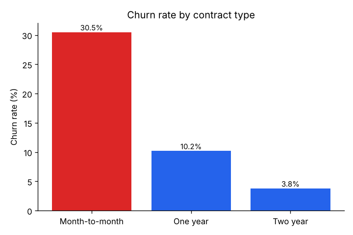
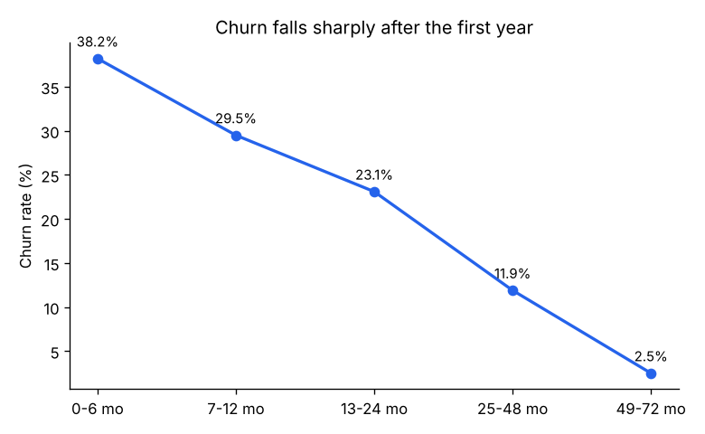
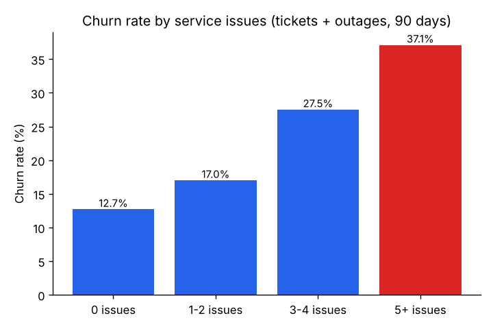
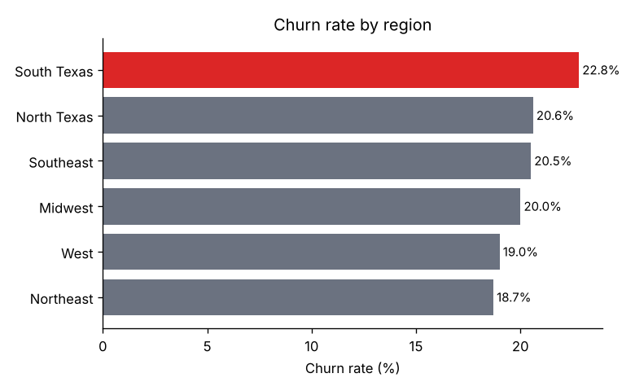
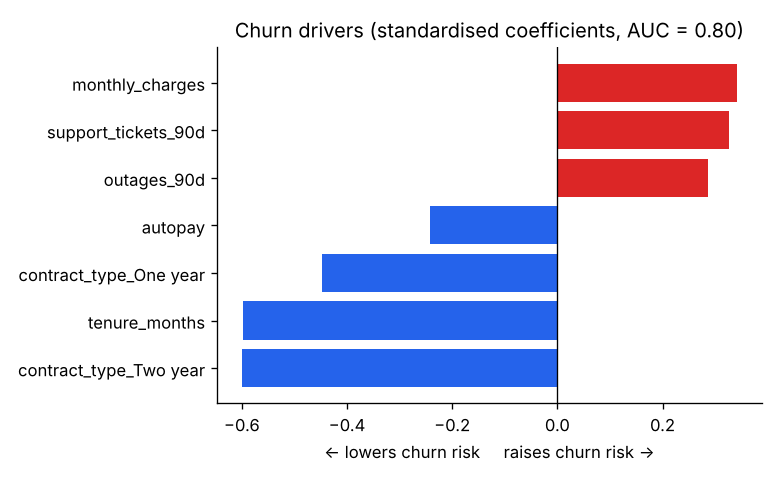

# Telecom Customer Churn Analysis


End-to-end analysis of why customers leave a broadband / cable provider, and which customers to target first.
Covers the full analyst workflow: profiling a messy extract, cleaning it with an audit trail, segment analysis in SQL,
an explainable risk model, and a plain-language summary for business stakeholders.

> **Data note:** all data is synthetic, generated by `src/generate_data.py`. No real customer data is used.



## Key findings

| Metric | Value |
|---|---|
| Customers analysed | 7,500 |
| Overall churn rate | 20.3% |
| Monthly revenue lost to churn | $140,554 |
| Churn, month-to-month vs two-year contract | 30.5% vs 3.8% |
| Churn, first 6 months vs 4+ years tenure | 38.2% vs 2.5% |
| Churn, 0 vs 5+ service issues (90 days) | 12.7% vs 37.1% |
| High-risk segment size / churn rate | 243 customers / 56.8% |
| Risk model AUC (held-out) | 0.80 |

**Recommendations** (full write-up in [`reports/summary.md`](reports/summary.md)):
- Offer a discounted 12-month contract to month-to-month customers at the 3–6 month mark.
- Trigger proactive outreach after a customer's 3rd ticket or outage in 90 days.
- Incentivise auto-pay enrolment at sign-up.
- Investigate network reliability in South Texas, the highest-churn region.

| | |
|---|---|
|  |  |
|  |  |

## Retention target list

[`reports/retention_target_list.csv`](reports/retention_target_list.csv) ranks the 500 **active** customers with the
highest predicted churn risk and lists the reasons a retention rep can act on (e.g. *month-to-month contract; first
year; 4 service issues in 90 days*). It turns the analysis into a call list.

## What this project demonstrates

- **Data quality work** – the raw extract contains duplicates, inconsistent labels, nulls and numbers stored as text.
  `src/clean.py` fixes each issue, logs how many rows were affected, and asserts the result is valid.
- **SQL** – aggregations, `CASE` bucketing, CTEs and window functions (`RANK() OVER`) in
  [`sql/churn_queries.sql`](sql/churn_queries.sql).
- **Python / Pandas / NumPy** – data generation, cleaning, group-wise imputation, feature engineering.
- **Modelling** – a standardised logistic regression chosen for explainability over raw accuracy.
- **Communication** – charts and a stakeholder summary written for a non-technical audience.

## Data-cleaning audit log

| Step | Rows affected |
|---|---|
| Removed exact duplicate rows | 70 |
| Trimmed / re-cased region labels | 120 |
| Standardised contract_type labels | 180 |
| Converted blank total_charges to numeric | 25 |
| Imputed missing monthly_charges (plan median) | 95 |
| Filled missing payment_method with 'Unknown' | 60 |

Column definitions, cleaning rules and metric definitions are in [`docs/data_dictionary.md`](docs/data_dictionary.md).

## Project structure

```
telecom-churn-analysis/
├── data/
│   ├── raw/customers.csv              # synthetic messy extract
│   └── processed/customers_clean.csv  # cleaned output
├── notebooks/churn_analysis.ipynb     # step-by-step exploratory walkthrough
├── reports/
│   ├── figures/                       # charts used above
│   ├── summary.md                     # stakeholder summary
│   ├── retention_target_list.csv      # top-500 at-risk active customers
│   └── metrics.json                   # all headline numbers
├── sql/churn_queries.sql              # named analysis queries
├── src/
│   ├── generate_data.py
│   ├── clean.py
│   └── analysis.py
├── run_all.py
└── requirements.txt
```

## How to run

```bash
python -m venv .venv && source .venv/bin/activate   # Windows: .venv\Scripts\activate
pip install -r requirements.txt
python run_all.py          # generate -> clean -> analyse; rebuilds every chart and report
jupyter notebook notebooks/churn_analysis.ipynb
pytest                     # 8 unit tests for the cleaning step
```

## Tools
Python · Pandas · NumPy · SQL (SQLite / PostgreSQL) · scikit-learn · Matplotlib · Jupyter
